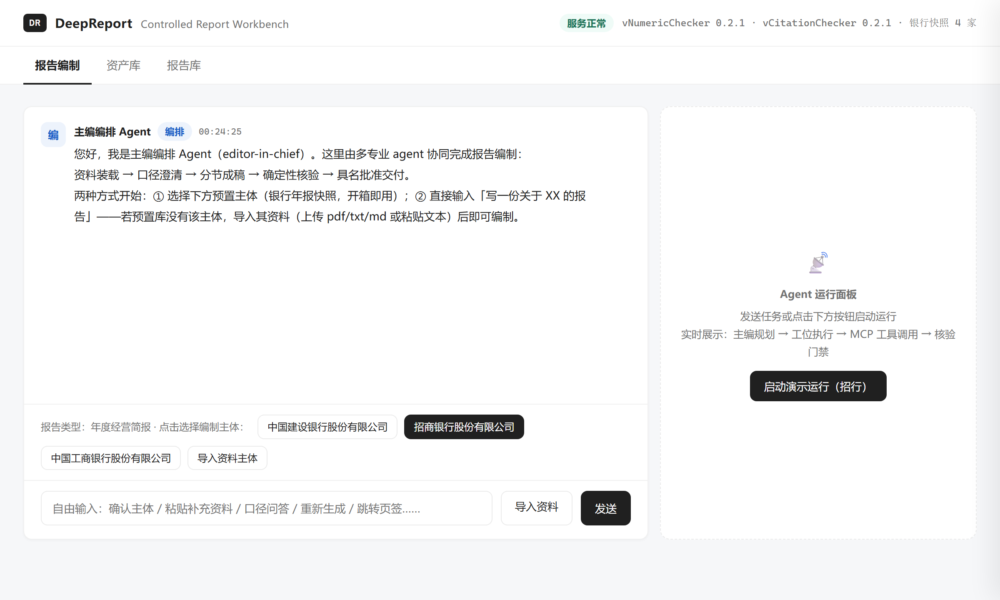
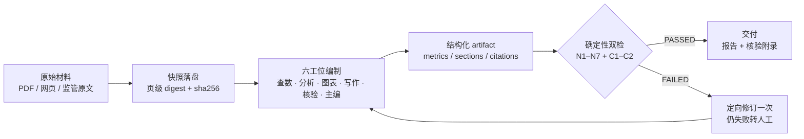

# DeepReport

[](#已知限制) · [](source/w06-annual-report-agent/pom.xml) · [](#实测数据) · [](#许可证)

[快速开始](#快速开始) · [工作流程](#工作流程) · [实测数据](#实测数据) · [设计文档](docs/opensource-comparison-and-plan.md) · [路线图](ROADMAP.md) · [已知限制](#已知限制)



*工作台「报告编制」页：六工位流水线、双检版本号、报告类型选择与资料导入。截图取自 2026-11-19 的开发验证实例。*

> **DeepReport 是一套受控长报告编制系统。** 材料先落盘成带指纹的快照，编制由报告画像配置驱动，交付前用**不调用模型**的数值与引用双检做门禁——检查失败即阻断交付（fail-closed，不是给建议），报告里每个数字都必须能追到来源页的原文摘录，追不到就不放行。

<details open>
<summary><b>目录</b></summary>

- [这是什么](#这是什么)
- [一眼看懂](#一眼看懂)
- [为什么需要它](#为什么需要它)
- [快速开始](#快速开始)
- [输出长什么样](#输出长什么样)
- [工作流程](#工作流程)
- [关键机制](#关键机制)
- [实测数据](#实测数据)
- [按目标导航](#按目标导航)
- [设计决策与代价](#设计决策与代价)
- [已知限制](#已知限制)
- [安全须知](#安全须知)

</details>

## 这是什么

银行年报、投研、客户分析、技术方案这类长报告，交付标准不是"写得流畅"，而是**可溯源、可核验、可审计**：一个比率写错了要能定位到哪一页、哪一句支撑；材料里没有的数字，不许由模型补出来。主流深度研究智能体擅长检索与长文生成，但把"引用是否真的支撑论断"交给生成模型自评，在强监管场景下不够。

DeepReport 把编制拆成三段，**核验独立于生成模型**：

1. **落盘** — 原始材料经 `/v1/documents/import` 注册进快照库（snapshot，落盘的原始材料及页索引），生成页级 `digest` 与 `sha256`；
2. **编制** — 报告画像（report profile，一类报告的模板、技能、指标字典与检查规则集合）由 `report_type` 选中，检索与初稿复用 [openJiuwen-DeepSearch](https://github.com/openJiuwen-ai/deepsearch/blob/main/deepsearch/README.md)（官方定义为"知识增强、高性能、高精度的深度检索与研究引擎"），六工位流水线产出结构化工件（artifact）；
3. **门禁** — 数值规则 N1–N7 与引用规则 C1–C2 做确定性检查，失败即阻断交付（定向修订一次，再失败转人工）。检查结论与批准记录都绑定工件指纹，改正文即全部失效。

交付物是结构化 artifact（`metrics` / `sections` / `citations` / `tables`）、带核验附录的报告、[`frontend/workbench.html`](frontend/workbench.html) 工作台，以及可复现的评测脚本。`main` 是领域无关通用内核主线，`annual-report` 是冻结的银行年报基线；已跑通年报、投研投顾、客户分析三类配置。

**当前状态：research preview。** 本系统保证的是"过程可回放、结论可核验、篡改可发现"，**不对材料源本身的真实性背书**——一致不等于正确。它目前适合作为「带核验的第二稿生成器 / 证据审计工具」，**不适合一键交付正式报告**，原因见 [已知限制](#已知限制)。

## 一眼看懂

[`benchmark/results.json`](benchmark/results.json) 里有一条真实标注用例，也是这套系统存在理由的最小例子：

| | 内容 |
|---|---|
| 报告里写 | `营业收入同比增长 0.85%` |
| 材料原文 | `不良贷款率 0.85%，同比下降。` |
| 判定 | **UNSUPPORTED**（无据，门禁不放行） |

数字确实在材料里，但**主体不对**：0.85% 属于不良贷款率，不属于营收。生成模型自评时很容易因为"数字命中"而放过，DeepReport 的 **L2 语境绑定核验**会比对数值前最近的主体词，归属不匹配就判无据。`benchmark/results.json` 里 15 条同类标注用例精确匹配 15/15（自构用例，非公开基准）。

## 为什么需要它

- **引用自评等于让被审计方写审计结论**：让生成模型判断自己的引用是否成立，缺少独立于生成过程的判定层。
- **材料里没有的数字会被顺手补出来**：一个比率写错，整篇报告的结论方向就反了；Phase 1 实测唯一一条 BLOCKING 违规，正是模型从外部知识带入、材料中根本不存在的「风险加权资产 282,699.48 亿」。
- **改一个字，旧结论仍挂在旧文本上**：没有工件指纹绑定，"已核验"无法证明对应的是哪一版正文。
- **换一类报告就要改编排代码**：年报的八项指标字典会被悄悄套到投研报告上，缺的指标直接 `NOT_FOUND`。

## 快速开始

服务以容器方式运行（`w06-checker`，Java HTTP 服务 + 工具网关 + 双检；宿主 `18083` → 容器 `18095`）。**前置条件**：容器已启动且 `/health` 返回正常；镜像由源码构建，尚未发布到公共 registry，仓库内的 `source/w06-annual-report-agent/deploy/compose.yaml` 是 Agent Bus 内部网络编排、不映射宿主端口，不能单独用来起本机服务（见 [已知限制](#已知限制)）。

服务起来之后，四行从"导材料"走到"出报告"：

```bash
BASE=http://localhost:18083

curl -s "$BASE/health"

curl -s -X POST "$BASE/v1/documents/import" -H 'Content-Type: application/json' \
  -d '{"title":"监管原文","authority":"PRIMARY_OFFICIAL","text":"……原文……"}'

curl -s -X POST "$BASE/v1/pipeline/run?async=1" -H 'Content-Type: application/json' \
  -d '{"bank":"live","mode":"long_form","report_type":"research","subject_hint":"研究标的"}'

curl -s "$BASE/v1/pipeline/status?run_id=<上一步返回的 run_id>"
```

第三步返回 `run_id` 后由后台线程池执行六工位（实测一次 `long_form` 约 5 分钟），第四步返回 `stages` 增量状态与最终 `checks`。**看到 `checks.numeric.status` 与 `checks.citation.status` 都出现，就算跑通**；只要有一个是 `FAILED`，报告不会被放行。可复制脚本见 [`examples/quickstart.sh`](examples/quickstart.sh)，单独调用双检可用 `POST /v1/checks/numeric` 与 `POST /v1/checks/citation`（请求体为 artifact JSON）。

> 想要能看到界面的路径：打开 `frontend/workbench.html` 对应的工作台，选报告类型 → 导入资料 → 点「启动演示运行」，右栏会实时点亮六个工位。

## 输出长什么样

一次编制返回的是**结构化工件**，不是一篇纯文本（节选，省略长字段；取自 2026-11-19 真实运行）：

```json
{
  "task_id": "TASK-2025-AR-008",
  "company": "…",
  "artifact_digest": "sha256:1c4c6a2ce55f78d8ccba7f4c9ba62bee6db59ed1a2c05cb11d8e2af349731721",
  "checks": {
    "numeric":  { "checker_version": "0.2.1", "status": "PASSED" },
    "citation": { "checker_version": "0.2.1", "status": "PASSED" }
  },
  "artifact": {
    "metrics": [
      { "key": "OPERATING_REVENUE", "value": "NOT_FOUND",
        "source_document_digest": "", "evidence_excerpt_digest": "" }
    ],
    "sections":  [ "<21 节正文，此处省略>" ],
    "citations": [ { "claim_id": "C-1", "source_document_digest": "e899725f…",
                     "evidence_excerpt": "…" } ]
  }
}
```

材料里没有营业收入，字段就写 `NOT_FOUND`，不让模型猜一个数；`artifact_digest` 把检查结论绑定到这一版工件，正文改一个字即指纹失配。报告正文里每个数字后面挂着可回查的引用标记（真实成品 [`artifacts/phase0_deepsearch_icbc_report.md`](artifacts/phase0_deepsearch_icbc_report.md)）：

```text
客户存款总额达到 373,117.78 亿元，较上年末增加 24,748.05 亿元，增幅为 7.10% [checked_citation:3][[1]](pages-005-008.txt)
```

## 工作流程



三段之间只传结构化数据与指纹：编制侧拿不到"放行权"，核验侧不调用模型、也无法改写正文。因此门禁结论可以脱离生成过程独立复现——代价是拦得住错误，但错误报告已经消耗过算力，且系统无法自证材料源真伪。

## 关键机制

1. **快照指纹绑定**：材料落盘即生成 `content_sha256` 与页级 `digest`，引用必须指向已注册信源页，否则引用检查不通过。
2. **证据摘录字面命中**：引用中的 `evidence_excerpt` 必须能在来源页文本中逐字找到，其 `sha256` 进引用三元组。区别于 DeepSearch 官方的「片段级溯源」（segment-level provenance），这里是更严格的字面绑定。
3. **L2 语境绑定核验**：比对数值前最近主体词的归属，区分「营收 0.85%」与「不良率 0.85%」；主体词表由画像注入，不硬编码领域词。
4. **派生值识别与推断标记器**：模型自行复算的百分比（官方 7.5% → 自算 7.52%）标为无法溯源；评价句式窗口 ∩ 材料零频词，按次自学习生成词表，标记 HIGH / LOW 两级无据定性论断，零领域硬编码。
5. **确定性双检 + fail-closed 门禁**：NumericChecker（N1–N7）与 CitationChecker（C1–C2）不调用模型；失败即阻断交付，定向修订一次，再失败转人工。
6. **报告画像配置驱动**：新增报告类型 = 加一份 profile + 骨架 + `index.json` 登记，注册环节 Java 编排层零改动（引擎对模板章节的遵循度仍不稳定，见 [已知限制](#已知限制)）。
7. **深搜桥接、主体隔离与工位上报**：非年报类型先调 DeepSearch `run_brief`，结果经 `snapshot_commit` 落盘后重新 scope；`subject_hint` 显式传递编制主体，避免混合主体库串数据；`?async=1` 启动后台线程池，`/v1/pipeline/status` 增量上报六工位状态。
8. **能力声明 → MCP 工具发现 → 通用桥执行 → 对账**：模板用 `capabilities` 声明要哪些图表/表格，并用 `source_of_truth` 指定数据以哪为准 → Agent 调标准 MCP `tools/list` 发现工具（MCP 即 Model Context Protocol，工具须先注册、由 Agent 发现后调用）→ 查 `capability-routes.json` → 经 `tools/call` 调 `table_compose` / `chart_render` → 回填 `artifact` → 第三道门禁核对声明是否都交付。**Skill 只写方法论、不执行**；生产网关的 `mcp_bridge` 把注册表中标记的工具统一转发到独立 MCP Server，新增工具改两份 JSON、零 Java 改动。2026-11-20 实跑：标准 MCP 与生产网关两条路径均 `PASSED`（3 声明 / 2 表 29 行 / 1 图 4 节点），空材料 `FAILED`。Java 六工位仍未自动触发路由；契约见 [`docs/capability-routing-design.md`](docs/capability-routing-design.md)，工具说明见 [`mcp/README.md`](mcp/README.md)，证据见 [`reviews/capability-mcp-live-run-1120.md`](reviews/capability-mcp-live-run-1120.md)。

## 实测数据

以下数字均为**本项目自测，非第三方基准**，测量口径与环境一并列出：

| 结果 | 口径与环境 |
|---|---|
| 年报 21/21 节、33,097 字、100 表、双检 PASSED | 2026-11-19，`main` + `bank=live` + `annual_report` + `long_form`；106 页工行 2025 年报快照；指标 8/8（6 项真值 + 2 项诚实 `NOT_FOUND`） |
| 632 条引用 → SUPPORTED 227 / PARTIAL 404 / UNSUPPORTED **1** | 2026-11-18，Phase 1 适配层对 Phase 0 报告逐条判定；唯一 BLOCKING 为模型从外部知识带入、材料中不存在的数字 |
| 15 例标注样本精确匹配 15/15，precision/recall/F1 = 1.0 | `benchmark/eval_checkers.py`，**15 例为自构标注用例**；1 例语义等价需模型层，结果见 [`benchmark/results.json`](benchmark/results.json) |
| 技术方案报告实测：14,922 字 / 52 引用 / 门禁 FAILED | 2026-11-19，5 份监管与实践材料 + 8 节自定义模板，耗时 392s；43 条 `PARTIAL_SUPPORT`、模板 8 节只生成 1 个主章节。这是一次**失败案例**，不是成功指标 |
| 能力路由闭环：3 条声明 → 3 条交付、2 次真实工具调用、门禁 PASSED | 2026-11-20 v0.1，`source/capability-router/router.py` 原型 + `18083` 真实工具端点 + 同批 5 份材料；产出 2 表 29 行 / 1 图 4 节点全带原文证据；空材料负向 `FAILED`（4 条 BLOCKING）。当时执行者在 Skill 脚本，见[v0.1 实跑记录](reviews/capability-routing-live-run-1120.md) |
| 能力下沉 MCP：两条路径均 PASSED、生产网关 9 工具真调用 | 2026-11-20 v0.2，`mcp/capability_server.py` + `ToolGateway::mcpBridge`；stdio 标准 MCP 与 gateway 生产网关各跑一次，3 声明全交付、2 表 29 行 / 1 图 4 节点；桥接返回 `ok=true, via=mcp_bridge`；未知工具仍 `unknown_tool`、原生 `table_extract` 回归正常；空材料 `FAILED`（6 条 BLOCKING）；重建镜像后复验一致。**网关已注册，六工位仍未接线**，见[MCP 实跑记录](reviews/capability-mcp-live-run-1120.md) |

更多历史运行（164,429 字符 / 632 引用 / 约 25 分钟的 Phase 0 E2E、航天飞鸿投研 v5 等）见 [`docs/phase0-validation-report.md`](docs/phase0-validation-report.md)。同类系统的公开基准可用于对照，但**本项目尚未在公开基准上评测**：GPT Researcher 在 DeepResearchGym 的引用精度 85.36% / 报告 83.70% / 覆盖 64.67%，STORM 在 NAACL 2024 报告引用召回 84.8% / 精度 85.2%；逐项对比见 [`docs/opensource-comparison-and-plan.md`](docs/opensource-comparison-and-plan.md)。

## 按目标导航

| 想做什么 | 去哪 |
|---|---|
| 跑一次完整编制 | [快速开始](#快速开始)、[`examples/quickstart.sh`](examples/quickstart.sh) |
| 看工作台长什么样 | 本页首图（报告编制页）；源码见 [`frontend/workbench.html`](frontend/workbench.html)，共三页：报告编制 / 资产库 / 报告库 |
| 理解核验规则与已知边界 | [`reviews/generalization-and-l2-fix-1117.md`](reviews/generalization-and-l2-fix-1117.md)、[`skills/verify_metrics_generic.py`](skills/verify_metrics_generic.py) |
| 新增一类报告 | [`source/config/report-profiles/`](source/config/report-profiles/)，约定见 [`BRANCHES.md`](BRANCHES.md) |
| 让模板声明的能力被 Agent 自动调度 | [`docs/capability-routing-design.md`](docs/capability-routing-design.md)、[`source/capability-router/router.py`](source/capability-router/router.py)、[MCP 实跑记录](reviews/capability-mcp-live-run-1120.md) |
| 注册新的 MCP 能力工具 | [`mcp/tools.json`](mcp/tools.json) + [`source/config/tools.json`](source/config/tools.json)（改两份 JSON，不改 Java），步骤见 [`mcp/README.md`](mcp/README.md) |
| 看设计取舍与整改计划 | [`docs/opensource-comparison-and-plan.md`](docs/opensource-comparison-and-plan.md)、[`ROADMAP.md`](ROADMAP.md) |
| 找 HTTP 接口 | `source/w06-annual-report-agent/` 内 `CheckerHttpServer` 路由表；调用示例见 [`frontend/workbench.html`](frontend/workbench.html) |

## 设计决策与代价

| 决策 | 换来什么 | 代价 |
|---|---|---|
| 核验做成生成之后的**独立门禁**，不放在生成模型内部 | 门禁结论不受生成模型自评影响，可独立复现 | 生成完才拦，错误报告已消耗算力；无法自证材料源真伪 |
| 材料先落盘成带指纹的快照再编制 | 引用可逐字回查、篡改可发现 | 多一次导入与索引；混合主体库必须显式传 `subject_hint`，否则会串数据 |
| fail-closed：缺指标 / 空模板一律 FAILED | 不把"没查到"包装成"已核验" | 材料不全时无法交付，必须人工补料 |
| 复用 DeepSearch 而非自研检索 | 拿到模板抽取、混合检索、片段级溯源 | 依赖外部引擎版本与网络；搜索 key 未配置时联网检索为空，降级到已导入资料 |

## 已知限制

> 学 STORM 把话说在前面：*当前产出不应直接作为正式报告发布*，结构补全与人工复核仍不可省。

- **能力已注册，但六工位尚未自动触发路由**：`table_compose` / `chart_render` 已是标准 MCP 工具，`18083` 的 `/v1/tools` 可发现 9 个工具、`/v1/tools/call` 可经通用 `mcp_bridge` 真执行（[设计](docs/capability-routing-design.md) / [MCP 实跑](reviews/capability-mcp-live-run-1120.md)）。但 Java `CheckerHttpServer` 六工位与 DeepSearch 引擎 agent 序列仍不读模板 `capabilities`，**线上报告编制不会因声明自动产出图表**：`requiredMetrics()` 零消费点、任务书技能硬编码、`extractDataTables()` 无条件执行、非年报 `charts` 硬编码空列表、批准门禁只跑 numeric + citation 都还没改。7 项接线点见实跑记录末节。
- **门禁只判编造、不判完整性（当前最严重）**：2026-11-19 用非预置主题「金融银行风控技术方案研究报告」实测，8 节里 5 节空白、8 项指标全 `NOT_FOUND`、仅 1 条引用，双检仍返回 `PASSED`。`NOT_FOUND` 被 N1 豁免、空节不触发任何规则，一份实质为空的报告会被放行。需要补章节覆盖率 / 证据密度的 completeness 规则。
- **模板注册 ≠ 模板遵循**：同一次实测注册 8 节技术方案模板后，引擎只生成「结论与建设建议」一个主章节，`SECTION_MISSING` 被门禁拦下；52 条引用中 43 条为 `PARTIAL_SUPPORT`。"加配置即决定报告结构"尚未兑现。
- **非预置报告类型静默回退**：`research` 骨架是投研八节，但指标字典仍是年报八项；`subject_hint` 不覆盖 `company` / `task_id` / 报告标题，实测把快照库名当成了研究标的。未登记类型应显式报错，而不是悄悄套用旧骨架。
- **没有一键部署**：容器镜像由源码本地构建、未发布到公共 registry；`source/w06-annual-report-agent/deploy/compose.yaml` 依赖 Agent Bus 的 external network，不映射宿主端口。真实搜索 key 仍是占位符，联网检索不可用，现有端到端验证全部走"材料模式"。
- 任务类型识别目前是**词表匹配**，不是 LLM 意图识别；Java 编排层仍有年报专用 `MetricKey` enum（61 处引用），值对象化未完成。
- 语义等价（ROE ↔ 净资产收益率）需 NLI/语义蕴含模型，确定性层一律保守降级人工；双检覆盖正文指标与引用，**不覆盖表格单元格**。
- 取数与分析偏浅：无付费/登录态信源接入；`table_extract` 只识别被拍平的财报表格，对条文类材料返回 0（实测对含财报的 `live` 快照全扫描可抽 100 表，此前记录中「实时抽取返回 0、不可靠」的结论已[更正](reviews/capability-mcp-live-run-1120.md)）；交付形态仅 HTML/JSON，无 PDF/Word/PPT 导出。
- 工程生产化缺口：未接 PostgreSQL 权威账本、执行身份 `o/a/b`、角色挂 RDC/Gateway，详见 [`reviews/w06-gap-vs-github-1117.md`](reviews/w06-gap-vs-github-1117.md)。

完整不足清单与逐条验收标准见 [`ROADMAP.md`](ROADMAP.md)。

## 安全须知

> ⚠️ 现有验证实例以公网裸 IP 直连、未启用鉴权（`SKIP_AUTH=true`），**仅用于开发验证**。不要导入真实客户数据、未公开财务数据或受监管材料。部署到生产前必须配置安全组白名单、鉴权与 TLS；导入材料的 `authority` 分级只是引用核验的信用标注，不构成访问控制。

## 路线图与参与

分支分工：`main` 为通用内核主线，`annual-report` 为冻结的银行年报基线（含工行 2025 年报成品），用于等价性回归；协作约定见 [`BRANCHES.md`](BRANCHES.md)。主要目录：`source/`（Java 工程与配置）、`skills/`（核验与推断标记脚本）、`frontend/`（工作台）、`benchmark/`（评测）、`docs/`（设计与验证）、`reviews/`（对标与历史评审）、`artifacts/`（报告成品）。

能力分层（模板 / Agent / Skill / MCP 四层职责）的契约定义见 [`docs/capability-routing-design.md`](docs/capability-routing-design.md)，MCP Server 与通用桥见 [`mcp/README.md`](mcp/README.md)，原文调研留痕见 [`reviews/capability-routing-research-1120.md`](reviews/capability-routing-research-1120.md)，生产端 7 项接线清单见 [MCP 实跑记录](reviews/capability-mcp-live-run-1120.md)。README 的重写调研留痕见 [`reviews/readme-rewrite-research-1119.md`](reviews/readme-rewrite-research-1119.md)。本仓由 `agent-hub-alpha` 的 W06 工作包演化而来，早期评审请求与架构审视保留在 `reviews/` 与 [`REVIEW-REQUEST.md`](REVIEW-REQUEST.md) 供追溯；历史文档中的 `Report Agent` / `W06` 为演变留痕，产品与仓库现已统一命名为 **DeepReport**（原 `Report-Agent` 地址由 GitHub 重定向）。

## 许可证

本仓库**当前未附 `LICENSE` 文件**，尚未明确授予开源使用许可。如需使用、分发或贡献代码，请先通过 Issue 与维护者确认授权方式，不要默认按 MIT / Apache-2.0 使用。

<details>
<summary><b>术语表（点开）</b></summary>

| 名词 | 含义与出处 |
|---|---|
| **DeepReport** | 本系统产品名。Deep（深度研究）+ Report（受控报告）；命名上与检索内核 DeepSearch 呼应：DeepSearch 管检索，DeepReport 管编制与放行。 |
| **DeepSearch** | [openJiuwen-DeepSearch](https://github.com/openJiuwen-ai/deepsearch/blob/main/deepsearch/README.md)：官方定义为"知识增强、高性能、高精度的深度检索与研究引擎"，基于 [openJiuwen agent-core](https://www.openjiuwen.com/) 协调多 Agent 完成查询规划、信息收集、理解反思与报告生成；官方首个应用场景是金融分析研报，支持「基于样例的报告生成」与「片段级结果溯源」。本项目复用其检索与初稿能力。 |
| **报告画像 / report profile** | 一类报告的领域资产集合：任务模板、领域技能、指标字典、检查规则，由 `report_type` 选中，配置见 `source/config/report-profiles/`。 |
| **快照 / snapshot** | 落盘的原始材料及其页索引。`live` 是用户导入资料形成的动态快照集；`cmb` / `icbc` / `ccb` 为冻结演示快照。 |
| **工件 / artifact** | 一次编制的结构化结果，含 `metrics` / `sections` / `citations` / `tables` / `charts`。 |
| **证据摘录 / evidence_excerpt** | 引用指向的原文片段，必须在来源页文本中**字面命中**，其 `sha256` 进引用三元组。 |
| **工件指纹** | `sha256(工件)`。检查结论与批准记录绑定它，正文改动即指纹失配。 |
| **双检** | NumericChecker（N1–N7 数值规则）+ CitationChecker（C1–C2 引用规则），确定性执行、不调用模型。 |
| **L2 语境绑定核验** | 引用支持度判定：数值前**最近主体词**的归属匹配；主体词表由 profile 注入。 |
| **fail-closed 门禁** | 检查失败不是"建议面"，而是阻断交付：打回定向修订一次，再失败转人工（源自 W06 的 GatekeepRail 改造）。 |
| **W06** | 上游 `agent-hub-alpha` 中"报告 Agent 与核验"工作包编号，仅见于 `reviews/` 历史文档。 |

</details>
