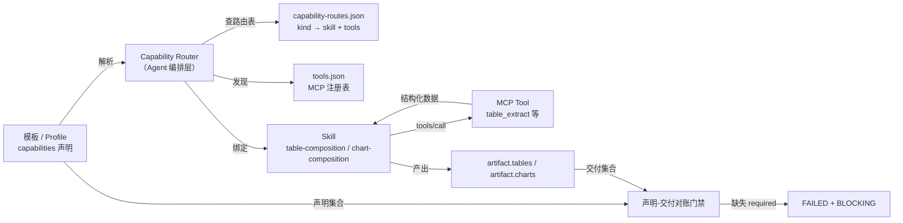

# 能力路由设计：模板 / Agent / Skill / MCP 四层职责契约

> 状态：**设计已落地为仓库内可运行原型，生产端尚未接线**。本文定义职责边界与契约，
> 实测证据见 [能力路由实跑记录](../reviews/capability-routing-live-run-1120.md)，调研原文见 [调研留痕](../reviews/capability-routing-research-1120.md)。

## 这是什么

DeepReport 是一套受控长报告编制系统：材料先落盘成带指纹的快照，编制由报告画像配置驱动，交付前用不调用模型的数值与引用双检做 fail-closed 门禁。
本文解决其中一个架构缺口：**报告需要的能力（图表、对比表、指标矩阵、引用粒度）散落在模板文字、Java 硬编码和一次性离线脚本里，没有任何一层负责「声明 → 路由 → 执行 → 对账」的闭环**。结果是年报成品有 51 张表 2 幅图，而 2026-11-19 实跑的风控技术方案报告 0 表 0 图，且门禁照样放行。

上一轮把这次缺失归因为「我写的模板没要求表格、材料里没有数值矩阵」，属于让人手工绕过架构缺陷。正确归因是**分层缺失**：模板没有机读能力声明、Agent 不解析声明也不选工具、图表能力从未注册进工具表、门禁不核对声明是否被交付。

## 名词（就地解释，来源为一手原文）

- **MCP（Model Context Protocol）**：模型调用外部工具的开放协议。服务端必须先声明 `capabilities.tools`，客户端通过 `tools/list` 发现工具、通过 `tools/call` 调用；每个工具用 `description` + `inputSchema` 描述契约。官方称工具是 **model-controlled**——"the language model can discover and invoke tools automatically based on its contextual understanding and the user's prompts"（[MCP Tools](https://modelcontextprotocol.io/docs/concepts/tools)）。
- **Agent Skill**：Anthropic 定义的可复用能力包，目录内含 `SKILL.md`（指令）、`scripts/`（确定性脚本）、`references/`（资料）。`name` 与 `description` 在启动时预载进 system prompt，构成 **progressive disclosure** 第一级；"Claude will use these when deciding whether to trigger the skill in response to its current task"（[Agent Skills 原文](https://www.anthropic.com/engineering/equipping-agents-for-the-real-world-with-agent-skills)）。官方明确 Skills 与 MCP **互补**：Skill 教 Agent 复杂工作流，MCP 提供外部工具。
- **Workflow 与 Agent 的区别**：Anthropic 的划分是 **workflows** "LLMs and tools are orchestrated through predefined code paths"，**agents** "LLMs dynamically direct their own processes and tool usage"（[Building effective agents](https://www.anthropic.com/engineering/building-effective-agents)）。DeepReport 目前的六工位是 workflow；用户要求的「模板建议有图表，Agent 就该知道并去调 Skill/MCP」属于 agent 侧的动态路由。
- **Report Profile（报告画像）**：本项目对某类报告的配置，如 `research.json` / `annual_report.json`，声明指标、骨架、词表；`index.json` 是类型注册表。
- **声明-交付对账（Declaration–Delivery Reconciliation）**：把模板声明的能力集合与工件实际交付的能力集合做集合差，缺失即阻断。

## 四层职责表

| 层 | 职责 | 明确不做 | 业界依据 |
|---|---|---|---|
| **模板 / Profile** | 用机读字段**声明**报告需要哪些产物：章节、`required_metrics`、`capabilities`（kind / spec / required / 数据来源） | 不写生成逻辑，不靠自然语言暗示，不塞数据 | MCP `capabilities.tools` 声明式 |
| **Agent / 编排** | **解析**声明 → 查路由表 → **决定**用哪个 Skill、调哪个 MCP 工具 → 依据工具返回**调整决策** → 回填工件 → 触发对账 | 不硬编码 `if (reportType)`，不静默跳过未满足的能力 | LangChain "model decides when to invoke"；Anthropic orchestrator-workers |
| **Skill** | 封装「怎么做」：从材料抽取数值矩阵成表、把结构化数据渲染成图、方法论与参数口径；可复用、可独立测试、可打包脚本 | 不绑定某一份报告，不自己决定何时被调用 | Agent Skills progressive disclosure |
| **MCP / Tool** | 原子执行：`table_extract` / `table_analyze` / 未来的 `chart_spec_build`；无状态、有 `inputSchema`、能单独冒烟 | 不决定自己该不该被调用 | MCP `tools/list` + `tools/call` |
| **门禁** | numeric / citation 之外，增加**声明-交付对账**；required 缺失 → `FAILED` + `BLOCKING` | 不用「没写就是不要」当豁免 | prompt chaining gate |

## 现状断点（逐条带证据）

| # | 断点 | 证据 |
|---|---|---|
| B1 | 模板层只有 `required_metrics` 一种声明，没有 `capabilities`；DeepSearch 模板是纯自然语言大纲 | `source/config/report-profiles/research.json:11`；`templates/research.md` |
| B2 | `requiredMetrics()` 解析了但**全仓零消费点**——声明没有被任何 Agent 或门禁读取 | `source/w06-annual-report-agent/checker/src/main/java/com/agenthub/w06/checker/ReportProfile.java:114` |
| B3 | 技能选择硬编码：任务书首句写死 `请先用 skill_tool 加载 annual-report 技能` | `.../checker/server/CheckerHttpServer.java:1635` |
| B4 | 工具调用硬编码：`extractDataTables(resolver, bank)` 无条件执行，不看模板是否声明、不看工具返回是否有表 | 同文件 `:1210` |
| B5 | 非年报工件 `charts` 是硬编码空列表，「图表」工位只是遍历空列表上报 | 同文件 `:1355` `new ArrayList<>()`、`:1272` 遍历 |
| B6 | 工具注册表 7 个工具全是检索/抽取类，**没有任何图表工具**；架构文档写明 `w06-charts 待注册` | `source/config/tools.json`；`source/w06-annual-report-agent/ARCHITECTURE-v3.md:156` |
| B7 | 批准门禁只跑 numeric + citation 两项，不核对模板声明的能力是否交付 | 同文件 `:643-653` |
| B8 | 引擎材料模式完全绕过工作台六工位，其 agent 序列只有 `outline / plan_reasoning / collector_summary / sub_reporter / end`，无能力路由 | 2026-11-19 实跑 `events.jsonl` |

B1–B8 共同解释了同一个现象：**年报的表格来自离线增强 artifact + 引擎对财报数值矩阵自发成表，不是通用链路的产物**。所以「图表能力」既不是丧失，也不是这次忘了用，而是**从未作为一层契约接进系统**。

## 目标链路



## 机制清单

1. **Capability Declaration**：模板 frontmatter 与 profile 的 `capabilities` 数组，字段 `id / kind / spec / required / source_of_truth`；声明只说要什么，不说怎么做。
2. **Capability Router**：读声明 → 查路由表 → 生成执行计划；路由表是配置，不是 `if-else`；计划含每个能力的 skill、候选 tools、失败策略。
3. **Tool Discovery**：调用前先比对 `tools.json` 注册表（等价 MCP `tools/list`）；未注册的能力记 `TOOL_UNREGISTERED`，**不静默降级**。
4. **Tool-Driven Decision**：Agent 依据工具真实返回调整下一步——例如 `table_extract` 对监管条文返回 `table_count:0` 时，转由 `table-composition` Skill 从材料抽取数值矩阵成表，并把这次转向写进决策日志。
5. **Skill Binding**：Skill 目录含 `SKILL.md`（方法）+ `scripts/`（确定性执行）；`name`/`description` 供路由表匹配，符合 progressive disclosure 第一级。
6. **Artifact Backfill**：Skill 产出统一写入 `artifact.tables` / `artifact.charts`，带 `capability_id` 反查键，供门禁对账。
7. **Declaration–Delivery Reconciliation**：`required ∩ delivered` 做集合差；缺一条即 `BLOCKING`，与 numeric/citation 并列为第三道门禁。

## 契约格式

模板 frontmatter（声明层）：

```yaml
---
report_type: risk_tech_solution
capabilities:
  - id: cap.capital_ratio_table
    kind: table
    spec: 资本充足率监管红线对比表（核心一级/一级/资本充足率/储备/逆周期）
    required: true
    source_of_truth: materials
  - id: cap.reg_clause_matrix
    kind: table
    spec: 监管条款与技术要求对照矩阵
    required: true
    source_of_truth: materials
  - id: cap.control_architecture_chart
    kind: chart
    chart_type: flow
    spec: 风控系统分层架构图（数据层/模型层/决策层/审计层）
    required: true
    source_of_truth: materials
---
```

路由表 `source/config/capability-routes.json`（编排层）：

```json
{
  "table": {
    "skill": "table-composition",
    "probe_tools": ["table_extract"],
    "fallback": "skill_compose_from_materials",
    "on_missing": "BLOCKING"
  },
  "chart": {
    "skill": "chart-composition",
    "probe_tools": [],
    "registered_tool": null,
    "note": "w06-charts 未注册，暂由 Skill 内确定性脚本承载",
    "on_missing": "BLOCKING"
  }
}
```

工件反查键：

```json
{"tables": [{"capability_id": "cap.capital_ratio_table", "headers": [], "rows": []}],
 "charts": [{"capability_id": "cap.control_architecture_chart", "chart_type": "flow", "svg": "<svg ...>"}]}
```

## 设计决策与代价

| 决策 | 理由 | 代价 |
|---|---|---|
| 声明放 profile + 模板 frontmatter，不引入新 DSL | 复用已有 `index.json` 配置驱动路径，Java/Python 都能解析 | frontmatter 与 profile 双处维护，需加一致性校验；本期未实现该校验 |
| **路由表配置驱动**，不让 LLM 自由选工具 | 金融报告要求可审计、可复现；路由决策必须能落日志、能追责 | 灵活性低于 model-controlled 工具选择；新增能力要先改路由表，不是模型自动泛化 |
| 图表先以 **Skill** 落地，不新注册 MCP server | Skill 可打包确定性脚本，符合 Anthropic「Skills 与 MCP 互补」；避免为渲染器单独起服务 | 图表能力暂不是可被任意 Agent 发现的 MCP 工具，`w06-charts` 仍待注册；跨进程复用受限 |
| 对账缺失判 `BLOCKING` 而非 `WARN` | 与既有 fail-closed 纪律一致，避免「空报告 PASSED」重演 | 所有历史报告在未补声明前都会 FAILED，需要一次性迁移 profile |
| Skill 产出只做确定性抽取/渲染，不调用模型 | 数字不进模型，避免编造；与项目「数字照抄原文、派生值来自脚本」纪律一致 | 无法从非结构化叙述中生成复杂可视化，覆盖能力受材料结构化程度限制 |

## 门禁对账规则

```
declared  = {c.id for c in template.capabilities if c.required}
delivered = {t.capability_id for t in artifact.tables} ∪ {c.capability_id for c in artifact.charts}
missing   = declared - delivered
status    = FAILED if missing else PASSED
violations = [{"rule":"CAPABILITY_MISSING","severity":"BLOCKING","target":id} for id in missing]
```

与 numeric / citation 的关系：**并列第三道门禁**，不替代前两道；三者全 PASSED 才允许批准。

## 已知限制

- 本设计为**仓库内可运行原型**（`source/capability-router/router.py` + 两个 Skill + 路由表），**生产端未接线**：Java `CheckerHttpServer` 的六工位、DeepSearch 引擎的 agent 序列都还没调用它。因此它证明「链路可行」，不证明「线上已修好」。
- `table_extract` 的实现只识别「拍平财报表格」（`tools.json` 描述），对监管条文纯文本返回 0；原型实测 `icbc` 年报快照全量扫描也返回 0（0.1s），说明当前部署上实时抽取并不可靠，不能当作已验证的成表能力。
- 路由表目前只覆盖 `table` / `chart` 两种 kind；引用粒度、指标矩阵、附录等尚未声明。
- 图表渲染只支持 `flow` / `bar`，且输出为内联 SVG；没有栅格化、没有可访问性标注。
- 原型未做并发、超时重试、工具鉴权；`18083` 仍是公网裸 IP 无鉴权，只应使用公开材料。
- 未实现「LLM 依据工具描述自主选工具」的 model-controlled 方案，与 MCP 官方 "model-controlled" 语义仍有差距；这是确定性与可审计性权衡后的主动收缩，不是遗漏。

## 复现

```bash
python source/capability-router/router.py \
  --template examples/capability-declared-template.md \
  --materials-dir <含 .txt 材料的目录> \
  --registry source/config/tools.json \
  --routes source/config/capability-routes.json \
  --tools-endpoint http://<host>:18083/v1/tools/call \
  --out capability_run_result.json
```

成功标志：输出 JSON 里 `status=PASSED`、`missing=[]`，且 `artifact.tables` / `artifact.charts` 中每一项都能用 `capability_id` 反查到模板声明。
