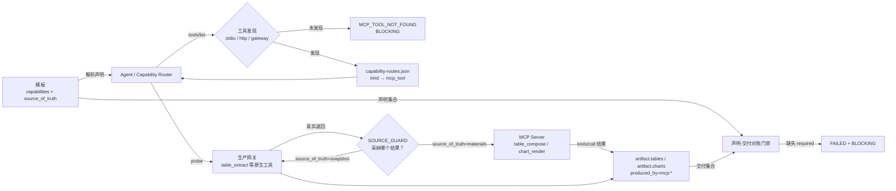
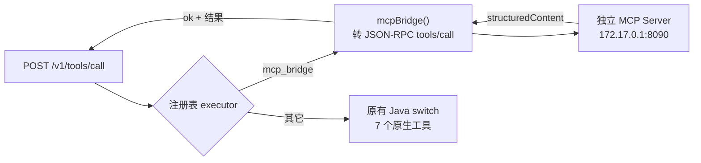

# 能力路由设计：模板 / Agent / Skill / MCP 四层职责契约

> 状态：**v0.2 已把成表/成图下沉为标准 MCP 工具，并在生产网关完成注册与桥接**；
> Java 六工位与 DeepSearch 引擎仍未自动触发路由。
> 一手调研见 [调研留痕](../reviews/capability-routing-research-1120.md)，
> v0.1 原型证据见 [能力路由实跑记录](../reviews/capability-routing-live-run-1120.md)，
> v0.2 MCP 落地与生产实测见 [MCP 实跑记录](../reviews/capability-mcp-live-run-1120.md)。

## 这是什么

DeepReport 是一套受控长报告编制系统：材料先落盘成带指纹的快照，编制由报告画像配置驱动，交付前用不调用模型的数值与引用双检做 fail-closed 门禁。
本文解决其中一个架构缺口：**报告需要的能力（图表、对比表、指标矩阵、引用粒度）散落在模板文字、Java 硬编码和一次性离线脚本里，没有任何一层负责「声明 → 路由 → 执行 → 对账」的闭环**。结果是年报成品有 51 张表 2 幅图，而 2026-11-19 实跑的风控技术方案报告 0 表 0 图，且门禁照样放行。

把缺失归因为「模板没写表格、材料里没有数值矩阵」，属于让人手工绕过架构缺陷。正确归因是**分层缺失**：模板没有机读能力声明、Agent 不解析声明也不选工具、图表能力从未注册进工具表、门禁不核对声明是否被交付。

v0.1 做出了闭环，但执行者仍是 Skill 里的本地脚本——能力存在，**不在 MCP 层**。v0.2 按「能 MCP 就尽量 MCP」把确定性执行上移为标准 MCP 工具，并在生产网关加通用桥，使工具真正可被 `tools/list` 发现、`tools/call` 调用。

## 名词（就地解释，来源为一手原文）

- **MCP（Model Context Protocol）**：模型调用外部工具的开放协议。服务端必须先声明 `capabilities.tools`，客户端通过 `tools/list` 发现工具、通过 `tools/call` 调用；每个工具用 `description` + `inputSchema` 描述契约。官方称工具是 **model-controlled**——"the language model can discover and invoke tools automatically based on its contextual understanding and the user's prompts"（[MCP Tools](https://modelcontextprotocol.io/docs/concepts/tools)）。
- **Agent Skill**：Anthropic 定义的可复用能力包，目录内含 `SKILL.md`（指令）、`scripts/`（可选脚本）、`references/`（资料）。`name` 与 `description` 在启动时预载进 system prompt，构成 **progressive disclosure** 第一级；"Claude will use these when deciding whether to trigger the skill in response to its current task"（[Agent Skills 原文](https://www.anthropic.com/engineering/equipping-agents-for-the-real-world-with-agent-skills)）。官方明确 Skills 与 MCP **互补**：Skill 教 Agent 复杂工作流，MCP 提供外部工具。本项目据此把 Skill 收敛为方法论，执行交给 MCP 工具。
- **Workflow 与 Agent 的区别**：Anthropic 的划分是 **workflows** "LLMs and tools are orchestrated through predefined code paths"，**agents** "LLMs dynamically direct their own processes and tool usage"（[Building effective agents](https://www.anthropic.com/engineering/building-effective-agents)）。DeepReport 目前的六工位是 workflow；「模板建议有图表，Agent 就该知道并去调 MCP」属于 agent 侧的动态路由。
- **Report Profile（报告画像）**：本项目对某类报告的配置，如 `research.json` / `annual_report.json`，声明指标、骨架、词表；`index.json` 是类型注册表。
- **声明-交付对账（Declaration–Delivery Reconciliation）**：把模板声明的能力集合与工件实际交付的能力集合做集合差，缺失即阻断。
- **通用 MCP 桥（mcp_bridge）**：生产网关不对每个新工具写一个 Java case，而是把注册表中标记 `executor=mcp_bridge` 的工具统一转成 JSON-RPC `tools/call` 转发给独立 MCP Server。

## 四层职责表（v0.2）

| 层 | 职责 | 明确不做 | 落地位置 |
|---|---|---|---|
| **模板 / Profile** | 用机读字段**声明**报告需要哪些产物：`capabilities`（kind / spec / required / `source_of_truth`） | 不写生成逻辑，不靠自然语言暗示，不塞数据 | `examples/capability-declared-template.md`、`source/config/report-profiles/research.json` |
| **Agent / 编排** | **解析**声明 → **tools/list 发现** → 查路由表 → 决定调哪个 MCP 工具 → 依据工具真实返回**调整决策** → 回填工件 → 触发对账 | 不硬编码 `if (reportType)`，不静默跳过未满足的能力，不在本地执行能力逻辑 | `source/capability-router/router.py`、`mcp/client.py` |
| **Skill** | 只封装**方法论**：何时用、参数怎么组织、失败如何降级；`mcp_tool` 字段声明所绑定的工具，供 Agent 做契约对齐校验 | **不执行**、不产出工件、不声明 `entry`、不再实现一份抽取/渲染逻辑 | `skills/table-composition/`、`skills/chart-composition/` |
| **MCP / Tool** | 原子执行：`table_compose` / `chart_render`（标准 MCP 工具）+ 生产网关原生 7 工具；无状态、有 `inputSchema`、可单独冒烟 | 不决定自己该不该被调用 | `mcp/tools.json`、`mcp/capability_server.py`、`source/config/tools.json` |
| **生产网关** | 通用 `mcp_bridge`：注册、发现、转发、回填 `structuredContent`；新增 MCP 工具零 Java 改动 | 不认识任何具体工具语义 | `ToolGateway.java::mcpBridge()` |
| **门禁** | numeric / citation 之外，增加**声明-交付对账**；required 缺失 → `FAILED` + `BLOCKING` | 不用「没写就是不要」当豁免 | `router.py` 门禁段；Java 侧第三道门禁仍未接 |

## 现状断点（逐条带证据）

| # | 断点 | 证据 | v0.2 状态 |
|---|---|---|---|
| B1 | 模板层只有 `required_metrics` 一种声明，没有 `capabilities` | `source/config/report-profiles/research.json:11` | 已加 `capabilities` 到模板 frontmatter |
| B2 | `requiredMetrics()` 全仓零消费点 | `ReportProfile.java:114` | Java 侧仍未消费 |
| B3 | 技能选择硬编码，任务书首句写死 `annual-report` | `CheckerHttpServer.java:1635` | 未改 |
| B4 | 工具调用硬编码，无条件执行 `extractDataTables` | 同文件 `:1210` | 未改 |
| B5 | 非年报工件 `charts` 硬编码空列表 | 同文件 `:1355`、`:1272` | 未改 |
| B6 | 注册表 7 个工具无图表工具，`w06-charts 待注册` | `source/config/tools.json`、`ARCHITECTURE-v3.md:156` | **已解决**：9 工具，`table_compose` / `chart_render` 经通用桥接入 |
| B7 | 批准门禁只跑 numeric + citation | 同文件 `:643-653` | 未改 |
| B8 | 引擎材料模式绕过六工位，agent 序列无能力路由 | 2026-11-19 `events.jsonl` | 未改 |

B6 已从「能力从未注册」变为「已注册且生产可调」；B2–B5、B7–B8 仍是**生产端接线**工作，不是设计缺口。

## 目标链路（v0.2）



`mcp_bridge` 在生产网关内的位置：



## 机制清单

1. **Capability Declaration**：模板 frontmatter 的 `capabilities` 数组，字段 `id / kind / spec / required / source_of_truth`；声明只说要什么、数据以哪为准，不说怎么做。
2. **Tool Discovery**：Agent 先调用标准 MCP `tools/list`（或生产网关 `GET /v1/tools`）拿到真实工具清单；路由表声明的 `mcp_tool` 不在发现结果中即 `MCP_TOOL_NOT_FOUND` + BLOCKING，**不静默降级到本地脚本**。
3. **Capability Router**：读声明 → 查 `capability-routes.json` → 生成执行计划；路由表是配置，不是 `if-else`。
4. **Skill Contract Check**：读 Skill 的 `mcp_tool` 字段与路由表比对，不一致判 `SKILL_CONTRACT_MISMATCH`；Skill 无 `entry`，从结构上杜绝「偷偷本地执行」。
5. **Source Guard**：依据模板 `source_of_truth` 决定采纳哪个工具结果。实测 `table_extract` 对 `live` 快照返回 100 张年报表，模板声明 `materials` 时**拒绝回填**（避免混合主体库串数据），改走 MCP 材料成表。
6. **Tool-Driven Decision**：Agent 依据工具真实返回调整下一步——`table_extract` 返回 0 或结果被 Source Guard 拒绝时，转向 `table_compose` / `chart_render`，转向原因写进决策日志。
7. **Generic MCP Bridge**：生产网关对 `executor=mcp_bridge` 的工具统一转发；端点与工具名从 `tools.json` 读，新增工具只改 JSON。
8. **Artifact Backfill**：MCP 工具产出统一写入 `artifact.tables` / `artifact.charts`，带 `capability_id` 与 `produced_by=mcp:*`。
9. **Declaration–Delivery Reconciliation**：`required ∩ delivered` 做集合差；缺一条即 `BLOCKING`，与 numeric/citation 并列为第三道门禁。

## 契约格式

模板 frontmatter（声明层）：

```yaml
---
report_type: risk_tech_solution
capabilities:
  - id: cap.capital_ratio_table
    kind: table
    spec: 资本充足率监管红线对比表（核心一级/一级/资本充足率/储备/逆周期）
    required: true
    source_of_truth: materials
  - id: cap.reg_clause_matrix
    kind: table
    spec: 监管条款与技术要求对照矩阵
    required: true
    source_of_truth: materials
  - id: cap.control_architecture_chart
    kind: chart
    chart_type: flow
    spec: 风控系统分层架构图（数据层/模型层/决策层/审计层）
    required: true
    source_of_truth: materials
---
```

MCP 工具契约 `mcp/tools.json`（执行层唯一事实源）：

```json
{"tools": [{
  "name": "table_compose",
  "description": "从原始材料文本确定性抽取数值矩阵或条款对照…",
  "inputSchema": {"type": "object", "properties": {"capability": {}, "materials": {}},
                  "required": ["capability", "materials"]},
  "executor": "compose_table"
}]}
```

路由表 `source/config/capability-routes.json`（编排层）：

```json
{
  "table": {
    "mcp_tool": "table_compose",
    "probe_tools": ["table_extract"],
    "fallback": "mcp_tool_from_materials",
    "methodology_skill": "table-composition",
    "on_missing": "BLOCKING"
  },
  "chart": {
    "mcp_tool": "chart_render",
    "registered_tool": "chart_render",
    "methodology_skill": "chart-composition",
    "on_missing": "BLOCKING"
  }
}
```

生产网关注册 `source/config/tools.json`：

```json
{"tool_id": "table_compose", "executor": "mcp_bridge",
 "mcp_tool": "table_compose",
 "default_args": {"mcp_endpoint": "http://172.17.0.1:8090/mcp"}}
```

工件反查键：

```json
{"tables": [{"capability_id": "cap.capital_ratio_table", "produced_by": "mcp:table_compose",
             "headers": [], "rows": []}],
 "charts": [{"capability_id": "cap.control_architecture_chart", "chart_type": "flow", "svg": "<svg ...>"}]}
```

## 设计决策与代价

| 决策 | 理由 | 代价 |
|---|---|---|
| 声明放模板 frontmatter + profile，不引入新 DSL | 复用已有配置驱动路径，Java/Python 都能解析 | frontmatter 与 profile 双处维护，需加一致性校验；本期未实现 |
| **路由表配置驱动**，不让 LLM 自由选工具 | 金融报告要求可审计、可复现；路由决策必须能落日志、能追责 | 灵活性低于 model-controlled；新增能力要先改路由表 |
| **能力执行下沉 MCP 工具，Skill 只留方法论**（v0.2 推翻 v0.1 的「图表先以 Skill 落地」） | 工具可被任意 MCP client 发现复用；消除 Skill 与 Server 两份实现；符合 Skills 与 MCP 互补 | 需要独立 MCP Server 进程，新增可用性依赖；本地 Agent 多一次进程/HTTP 跳转 |
| **生产网关用通用 `mcp_bridge`，不每工具一个 Java case** | 新增 MCP 工具只改两份 JSON，零 Java 改动 | 多一次 HTTP 跳转；桥接 fail-closed，Server 不可达即工具失败 |
| `source_of_truth` 由 Agent 消费，决定采纳哪个工具结果 | 快照库混有多主体数据时避免串数据 | 多一道 Source Guard 判定；模板必须显式声明数据来源，漏写会回退到 `materials` |
| 对账缺失判 `BLOCKING` 而非 `WARN` | 与既有 fail-closed 纪律一致，避免「空报告 PASSED」重演 | 历史报告在未补声明前都会 FAILED，需一次性迁移 profile |
| 工具只做确定性抽取/渲染，不调用模型 | 数字不进模型，避免编造；与「数字照抄原文、派生值来自脚本」纪律一致 | 无法从非结构化叙述生成复杂可视化，覆盖能力受材料结构化程度限制 |

## 门禁对账规则

```
declared  = {c.id for c in template.capabilities if c.required}
delivered = {t.capability_id for t in artifact.tables if t.rows} ∪
            {c.capability_id for c in artifact.charts if any(n.evidence for n in c.nodes)}
missing   = declared - delivered
status    = FAILED if missing else PASSED
violations = [{"rule":"CAPABILITY_MISSING","severity":"BLOCKING","target":id} for id in missing]
```

与 numeric / citation 的关系：**并列第三道门禁**，不替代前两道；三者全 PASSED 才允许批准。
另有三条前置阻断规则：`MCP_TOOL_NOT_FOUND`、`SKILL_CONTRACT_MISMATCH`、`MCP_CALL_FAILED`。

## 已知限制

- **生产端仍未自动接线**：Java `CheckerHttpServer` 六工位、DeepSearch 引擎 agent 序列都还没调用 router。目前是 Python Agent 原型驱动，`18083` 只提供了可被发现、可被调用的工具；报告编制不会因模板声明自动出图表。
- **更正一处此前误判**：v0.1 记录曾称「`table_extract` 全量扫描返回 0、实时抽取不可靠」。实测 `bank=live` 全扫描返回 `table_count=100`（221 页快照含年报财务表），此前结论源于指定页码/无表格快照集，不能推广。年报成品的 tables 有离线增强 artifact 一路，但**不等于实时抽取能力缺失**。
- MCP 工具当前只有 `table_compose` / `chart_render`，`chart_render` 只实现 `flow`；`bar` 等在 Skill 方法论中规划但未实现。
- 路由表只覆盖 `table` / `chart` 两种 kind；引用粒度、指标矩阵、附录尚未声明。
- 图表输出为内联 SVG，无栅格化、无可访问性标注（仅有 `role="img"` 与 `aria-label`）。
- `18083` 仍是公网裸 IP 无鉴权；MCP Server 只绑 `172.17.0.1` 不对外，但网关会接收调用方传入的材料原文，只应使用公开材料。
- 未实现「LLM 依据工具描述自主选工具」的 model-controlled 方案，与 MCP 官方语义仍有差距；这是确定性与可审计性权衡后的主动收缩，不是遗漏。
- 桥接未做并发限流、超时重试分级与工具鉴权。

## 复现

```bash
# 标准 MCP stdio（本地闭环）
python3 source/capability-router/router.py \
  --template examples/capability-declared-template.md \
  --materials-dir <含 .txt 材料的目录> \
  --out out.json

# 生产网关映射（tools/list 发现 9 个工具，桥接真调用）
python3 source/capability-router/router.py \
  --materials-dir <材料目录> \
  --mcp-transport gateway --mcp-url http://<host>:18083 \
  --out out_gateway.json

# 直接验证 MCP Server
python3 mcp/capability_server.py --selftest
python3 mcp/capability_server.py --transport http --host 172.17.0.1 --port 8090
```

成功标志：`status=PASSED`、`missing=[]`、`mcp_discovery.tools` 含 `table_compose` / `chart_render`，且 `artifact` 每项 `produced_by=mcp:*`；空材料目录应为 `FAILED` + 多条 BLOCKING。
部署与生产实测细节见 [`mcp/README.md`](../mcp/README.md) 与 [MCP 实跑记录](../reviews/capability-mcp-live-run-1120.md)。
