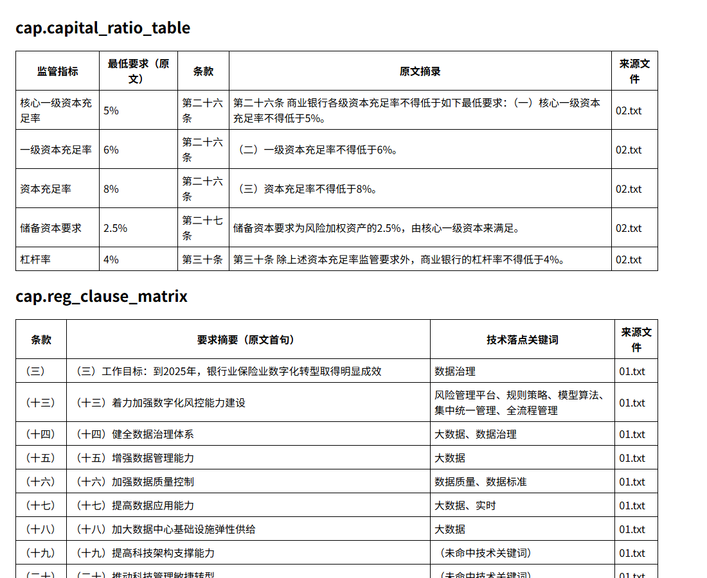
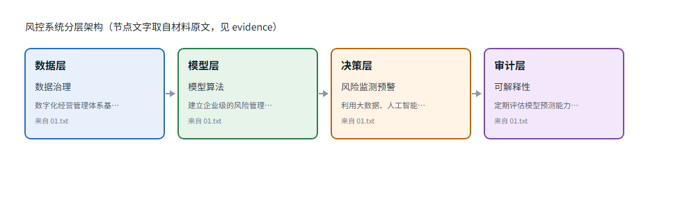

# 能力路由闭环实跑记录（2026-11-20）

> 结论先说人话：**模板声明「要图表」→ Agent 读懂并去调工具 → 工具没产出就转 Skill → 回填工件 → 门禁核对声明有没有都交付**，这条链路在仓库内原型上真跑通了。
> 但**生产端（Java 六工位 / DeepSearch 引擎）还没有调用它**，所以本记录证明「链路可行」，不证明「线上已修好」。

## 运行条件

| 项 | 值 |
|---|---|
| 时间 | 2026-11-20 01:00–01:03 GMT+8 |
| 命令 | `python source/capability-router/router.py --materials-dir <5 份风控材料> --out capability_run_result.json --markdown-out ... --html-out ...` |
| 工具端点 | `http://192.144.137.185:18083/v1/tools/call`（真实远端 MCP 风格网关，非 mock） |
| 材料 | 2026-11-19 实跑同一批 5 份监管/案例原文，`deepreport_eval/materials/*.txt` |
| 模板 | `examples/capability-declared-template.md`，frontmatter 声明 3 条 `capabilities` |

## 四层逐步证据

| 层 | 实际发生 | 日志证据 |
|---|---|---|
| 模板声明 | frontmatter 解析到 3 条：`cap.capital_ratio_table` / `cap.reg_clause_matrix` / `cap.control_architecture_chart` | `decision_log[0] DECLARATION` |
| Agent 发现 | 读 `source/config/tools.json`，得到 7 个已注册 `tool_id`（等价 MCP `tools/list`） | `decision_log[1] DISCOVERY` |
| MCP 调用 | 对两个 table 能力各调一次 `table_extract`，真实返回 `ok=true, table_count=0` | `tool_calls` 2 条 |
| Agent 决策 | 因 `table_count=0`，按路由表 `fallback=skill_compose_from_materials` 转 `table-composition` Skill；chart 因 `registered_tool=null` 直接绑定 `chart-composition` | `DECISION` 3 条 |
| Skill 执行 | 读各自 `SKILL.md` 的 `entry`，确定性执行 `compose.py` / `render.py`，不调用模型 | `SKILL_BINDING` 3 条 |
| 工件回填 | `artifact.tables` 2 张（5 行 + 24 行）、`artifact.charts` 1 幅（4 节点全部带 evidence） | `BACKFILL` 3 条 |
| 门禁对账 | `declared=3 / delivered=3 / missing=[]`，`PASSED`，0 violations | `gate` |

## 产物不是编的

- 资本红线表 5 行全部来自 `02.txt` 原文，带字面摘录：`核心一级资本充足率 5%`、`一级资本充足率 6%`、`资本充足率 8%`、`储备资本要求 2.5%`、`杠杆率 4%`。
- 条款矩阵 24 行按中文条款号切段，每行含原文首句 + 命中的技术落点词 + 来源文件；未命中关键词的行如实写「（未命中技术关键词）」。
- 架构图 4 个节点文字均取自 `01.txt` 原句，每节点带 `evidence` 与 `source_file`；渲染为内联 SVG，全元素显式填色。





## 正向 / 负向对照

| 运行 | 材料 | status | declared | delivered | missing | BLOCKING |
|---|---|---|---|---|---|---|
| 正向（真实工具端点） | 5 份原文 | **PASSED** | 3 | 3 | 0 | 0 |
| 负向（`--offline`，空材料目录） | 0 份 | **FAILED** | 3 | 0 | 3 | 4（3×`CAPABILITY_MISSING` + 1×`MATERIALS_EMPTY`） |

负向运行里 Skill 仍返回了 2 个空表壳和 1 个无证据图，但门禁**不把空壳算作已交付**——这正是 2026-11-19「空报告 PASSED」缺陷的对症规则。

## 一次实现 bug 的修复留痕

首跑 `FAILED`，`decision_log` 显示两个原因，均已修复并复跑：

1. `subprocess.run(input=..., stdin=PIPE)` 参数冲突 → `stdin and input arguments may not both be used`；去掉显式 `stdin` 后由 `input` 自动建管道。
2. 工具注册表字段是 `tool_id`，原型误读为 `id`/`name`（后者是中文显示名），导致误报 `TOOL_UNREGISTERED`。改为 `tool_id → id → name` 回退链。

修复前 `tool_calls=0`，修复后 `tool_calls=2` 且真实返回 `ok=true`。

## 不证明什么

- 不证明线上工作台能产出图表：Java `CheckerHttpServer` 与 DeepSearch 引擎的 agent 序列都还没调用 `capability-router`。
- 不证明 `table_extract` 可靠：本次对 `live` 快照返回 0，2026-11-19 对 `icbc` 年报快照全量扫描同样返回 0（0.1s）。它只识别被 PDF 拍平的财报表格，条文类材料本就不适用。
- 不证明 LLM 能自主选工具：本原型是配置驱动路由，主动放弃了 MCP 官方 "model-controlled" 的灵活性，换金融场景要的可审计与可复现。
- 不证明图表能力已注册：`w06-charts` 在 `ARCHITECTURE-v3.md:156` 仍标注「待注册」，当前由 Skill 内确定性脚本承载。

## 生产端接线清单（下一步，按依赖顺序）

| # | 改动点 | 具体位置 |
|---|---|---|
| 1 | 让 `ReportProfile` 暴露 `capabilities()` 并在任务书组装时注入能力清单 | `.../checker/ReportProfile.java:114`、`CheckerHttpServer.java:1626` |
| 2 | 把 `buildTaskBook()` 首句硬编码的 `annual-report` 技能改为按 `capabilities` 查 `capability-routes.json` 绑定 | `CheckerHttpServer.java:1635` |
| 3 | 把 `extractDataTables()` 的无条件调用改为「声明里有 table 才探测」，并接住 `table_count=0` 的 fallback | `CheckerHttpServer.java:1210` |
| 4 | 去掉 `emptyArtifactFromSkeleton()` 里 `charts = new ArrayList<>()` 的硬编码空列表，改为回填路由结果 | `CheckerHttpServer.java:1355` |
| 5 | 在批准门禁并列第三道「声明-交付对账」 | `CheckerHttpServer.java:643-653` |
| 6 | 把 `chart_spec_build` 注册进 `tools.json` 与 Agent Bus 能力卡，替换 Skill 内的临时渲染 | `source/config/tools.json`、`ARCHITECTURE-v3.md:156` |
| 7 | DeepSearch 引擎侧增加 capability agent，或在模板注册时把 frontmatter 声明透传给编排层 | 引擎 `/tmp/deepsearch-eval/`（远端，本仓未含其源码） |

## 复现

```bash
python source/capability-router/router.py \
  --template examples/capability-declared-template.md \
  --materials-dir <含 .txt 材料的目录> \
  --out capability_run_result.json \
  --markdown-out capability_artifacts.md \
  --html-out capability_artifacts.html
```

成功标志：`status=PASSED`、`missing=[]`、`tool_calls` 有真实端点返回、`artifact.tables/charts` 每项可用 `capability_id` 反查模板声明。
设计契约见 [`docs/capability-routing-design.md`](../docs/capability-routing-design.md)，调研原文见 [`reviews/capability-routing-research-1120.md`](capability-routing-research-1120.md)。
